<div align="center">

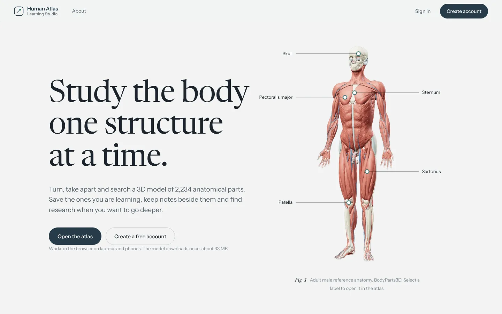

# Human Atlas Learning Studio

### Study the body one structure at a time.

A full-stack anatomy learning platform built around a real 3D model of **2,234 anatomical parts**: private study spaces, notes, PubMed research, role-based authentication and an admin dashboard. It has an animated interface that runs smoothly on both laptops and phones.

<p>
  <a href="https://human-atlas-learning-studio-ca.vercel.app"></a>
</p>

<p>
  
  
  
  
  
  
  
  
  
  
</p>

**[Live demo](https://human-atlas-learning-studio-ca.vercel.app)** · **[Evaluation accounts](#-evaluation-accounts)** · **[Rubric](#-ca-rubric-checklist)** · **[Run locally](#-run-it-locally)** · **[Deploy](#-deployment-vercel--mongodb-atlas)** · **[API](#-rest-api)**

</div>

---

## 🔑 Evaluation accounts

Sign in at **[/login](https://human-atlas-learning-studio-ca.vercel.app/login)**, on the live site or locally.

| | Role | Name | Email | Password | Start here |
| :-: | --- | --- | --- | --- | --- |
| 🛡️ | **Administrator** | Adhyayan Sonare | `admin@humanatlas.test` | `Admin@Atlas2026` | `/app/admin`: live totals, most-saved structures, every user |
| 🎓 | **Student** | Riya Sharma | `riya.sharma@humanatlas.test` | `Student@Atlas2026` | `/app/study-space`: 5 saved structures and 4 notes ready to explore |

- The **Evaluation accounts** card on the sign-in page fills in these details. You still select **Sign in**, which runs the real check: bcrypt against MongoDB, then a signed session cookie.
- Both are **ordinary users** in MongoDB with bcrypt-hashed passwords. They are created automatically the first time the server reaches the database.
- They are **protected**, because their credentials are public: their name and password can't be changed, and admins can't delete them. To try profile editing, password change and account deletion, **register your own account** at `/register`.

---

## 🧭 At a glance

<table>
<tr>
<td width="50%" valign="top">

**For students**
- 🧬 Explore **2,234** 3D parts across **15** systems
- 🔍 Search **3,432** named structures
- 🔖 Save structures to a private **Study Space**
- 📝 Write, edit and delete **notes** on each one
- 📚 Pull up the 5 most relevant **PubMed** articles
- 👤 **Profile** with activity, rename and password change

</td>
<td width="50%" valign="top">

**For evaluators**
- ⚛️ **React 19** frontend, 9 pages, **GSAP** animation
- 🟢 **Node.js + Express 5** REST API (20 endpoints)
- 🍃 **MongoDB**: `users`, `savedStructures`, `studyNotes`
- 🔐 **JWT** in an HttpOnly cookie, **bcrypt**, **roles**
- 🌐 External API: **NCBI PubMed E-utilities**
- ✅ **14** automated tests · deployed on **Vercel**

</td>
</tr>
</table>

---

## ✅ CA rubric checklist

| Requirement | | Where to see it |
| --- | :-: | --- |
| Frontend in HTML, CSS, JavaScript and **React** | ✅ | `client/`: React 19 + React Router 7, built with Vite |
| Backend in **Node.js** | ✅ | `server/`: Express 5 REST API (runs as a Vercel function in production) |
| **MongoDB** persistence, visible in Compass | ✅ | Database `human_atlas_studio`: `users`, `savedStructures`, `studyNotes` |
| Frontend ↔ backend integration | ✅ | Study Space, Profile and Admin data all come from MongoDB through `/api` |
| **Authentication**: register, login, logout | ✅ | `/register`, `/login`, Sign out; bcrypt + JWT in an HttpOnly cookie |
| Protected pages and protected API | ✅ | `/app/*` redirects to sign-in; private endpoints return `401` |
| **Role-based access** (student / admin) | ✅ | `/app/admin` and `/api/admin/*` return `403` for students |
| Login page and hero page | ✅ | `/login` and the animated landing hero `/` |
| Additional meaningful pages | ✅ | Atlas, Systems, Study Space, Profile, Admin, About |
| **External API** integration | ✅ | PubMed: "Related research" for any structure |
| CRUD | ✅ | Saved structures · notes · profile · admin user management |
| Validation and error handling | ✅ | Client and server validation with clear messages; consistent JSON errors |
| Responsive, accessible UI | ✅ | 1440 → 360 px; keyboard focus; reduced-motion support |
| Automated tests | ✅ | `npm test`: 14 integration tests, including the serverless handler |
| **Deployed** | ✅ | [human-atlas-learning-studio-ca.vercel.app](https://human-atlas-learning-studio-ca.vercel.app) |

---

## 🎬 Feature tour

### The landing page
The hero is an anatomical plate built from five **real renders** of the 3D model (muscles, skeleton, circulation, organs, skeleton and organs), all shot from the same camera, so they line up exactly.
- **Scan-line wipe:** layers swap on a timer, and each layer button shows its own progress.
- **X-ray lens:** hover over the figure to see the skeleton beneath the cursor.
- **Leader-line labels:** they draw in and open that exact structure in the Atlas.

Scroll down for **"Take it apart"**, a pinned scene that dissolves through six real explode renders (0% to 100%) as you scroll. After it come count-up figures, system marquees that react to scroll speed, a timeline that draws itself and a closing statement that lights up word by word.

<p align="center">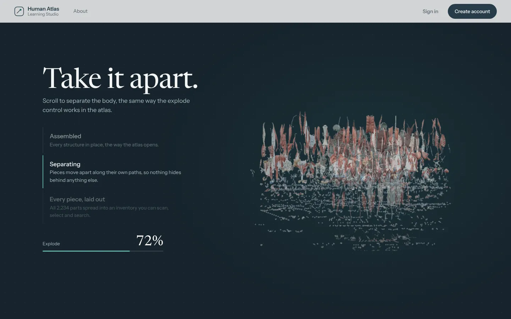</p>

### The 3D Atlas (`/app/atlas`)
Orbit, zoom, isolate and explode the model, and switch any of the 15 systems on or off. Select a structure, then:
- **Save** it,
- write a **Note**,
- open **Research**.

Deep links work: `/app/atlas?structure=FMA7088` opens the heart, and `/app/atlas?system=skeletal` shows the skeleton only.

<p align="center">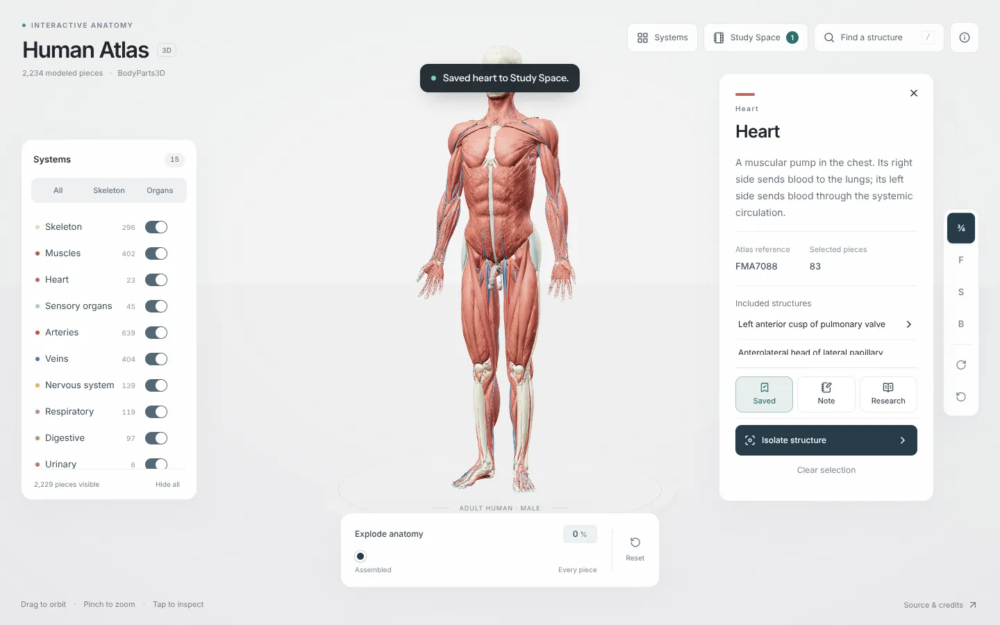</p>

### Study Space, Systems, Admin and Profile

| Study Space | Systems |
| :-: | :-: |
| 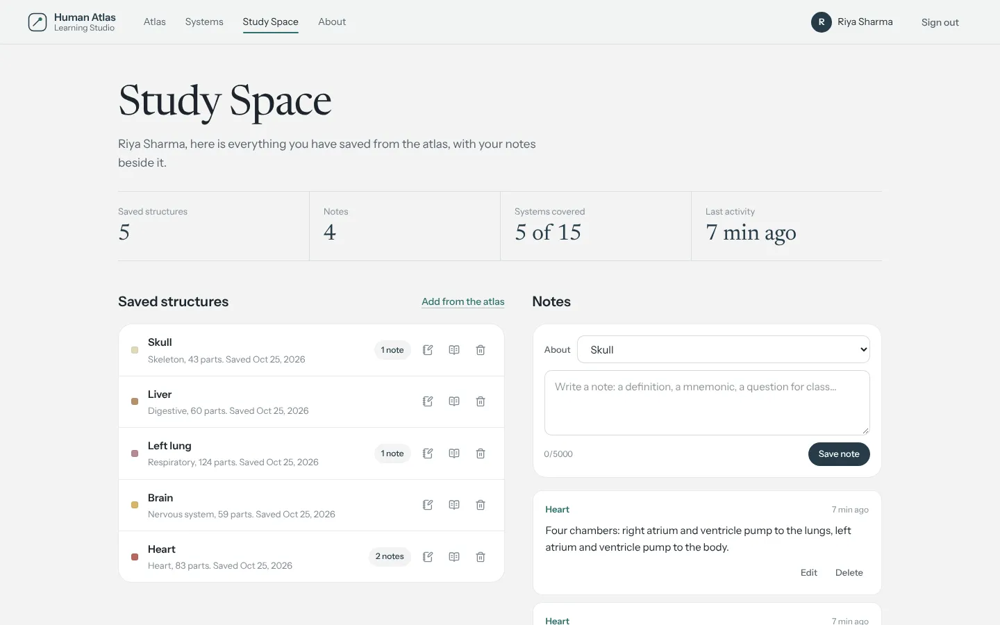 | 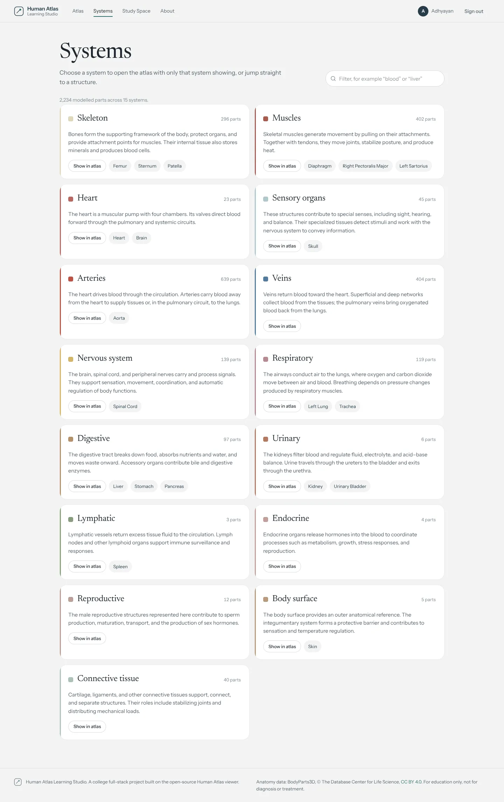 |
| Saved structures, notes (create, edit, delete, filter) and live statistics | 15 systems with live part counts and one-click "Show in atlas" |
| **Admin dashboard** | **Profile** |
| 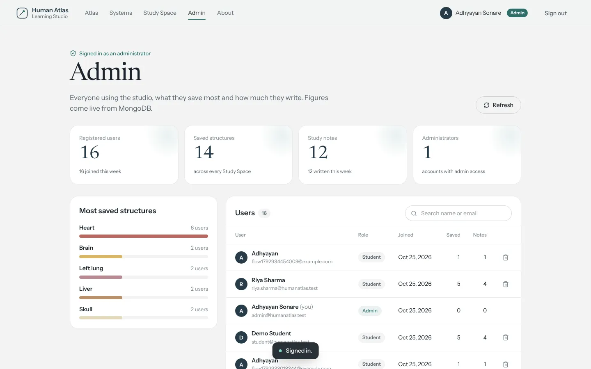 | 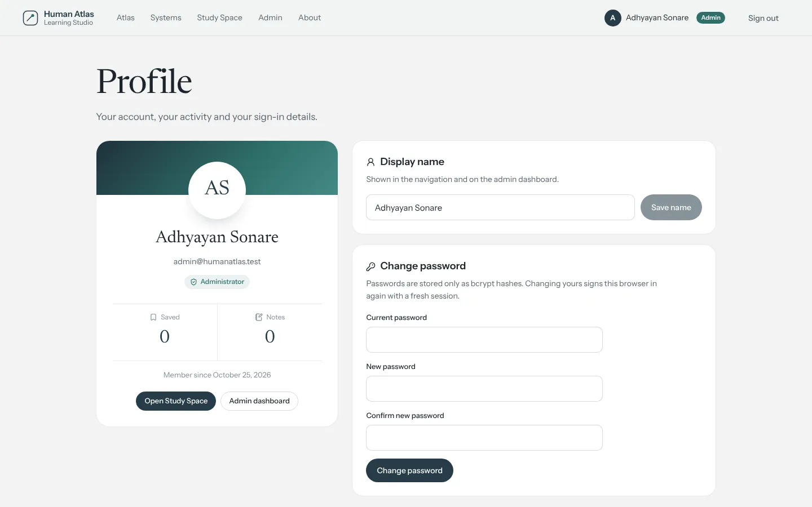 |
| Totals from MongoDB, most-saved structures and a searchable user table with delete | Avatar, role, activity, rename and password change (current password required) |

<table>
<tr>
<td width="62%">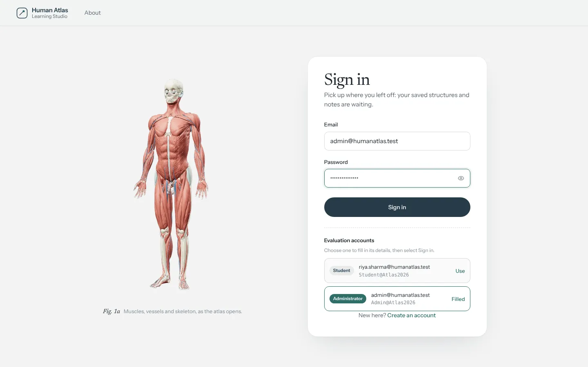</td>
<td width="38%" align="center">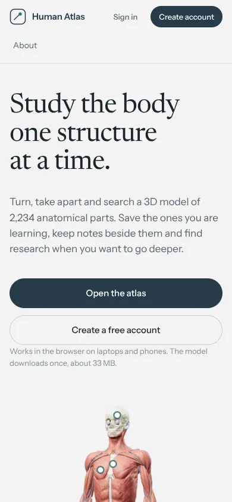</td>
</tr>
<tr><td align="center"><sub>Sign in, with the evaluation accounts card</sub></td><td align="center"><sub>On a phone</sub></td></tr>
</table>

---

## 🏗️ Architecture

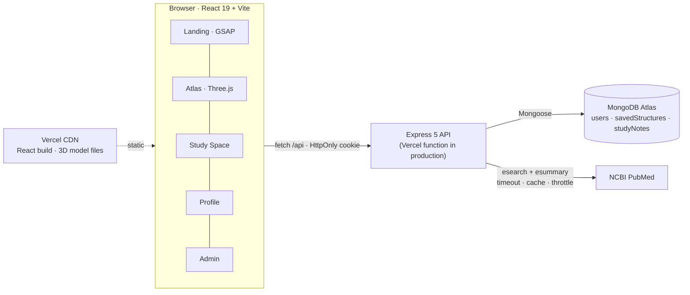

| Environment | Frontend | API | Database |
| --- | --- | --- | --- |
| **Local** | Vite dev server on `:3016` (proxies `/api`) | Express on `:5050` | Local MongoDB on `:27017` |
| **Production** | Vercel CDN (`client/dist`, model files cached for a year) | `api/index.mjs` → Express as a serverless function | MongoDB Atlas |

The site and the API share one domain in both environments, so the session cookie is always first-party and no CORS setup is needed.

---

## 🚀 Deployment (Vercel + MongoDB Atlas)

The live site runs from this repository with no manual build steps. Every push to `main` redeploys automatically.

### How it's wired
- **`vercel.json`** installs `server/` and `client/`, builds the React app into `client/dist`, routes `/api/*` to the function and every other path to the single-page app. It also caches the anatomy model files and keeps them out of the function bundle (7 MB instead of 100 MB).
- **`api/index.mjs` → `server/src/vercel.js`** creates the Express app once per instance and reuses the MongoDB connection between requests.
- **Database:** MongoDB Atlas, connected through Vercel's MongoDB Atlas integration, which sets `MONGODB_URI` for the project.

### Is JWT auth safe on Vercel?
Yes:
- The token lives in an **HttpOnly, Secure, SameSite=Lax** cookie, so page scripts can't read it and it only travels over HTTPS.
- Because the API is on the same domain as the site, the cookie is first-party.
- The **signing secret** is `JWT_SECRET` if you set one. Otherwise the server generates a 384-bit secret once and stores it in MongoDB (`appConfig` collection), so sessions survive restarts and cold starts. The secret never appears in code or in the repository.
- **Rate limiting** trusts Vercel's proxy, so each visitor is limited by their own IP address.

### Deploy your own copy
1. **Import** the repository at [vercel.com/new](https://vercel.com/new). Choose the **Other** preset; `vercel.json` handles the rest.
2. **Add a database:** Project → *Storage* → *MongoDB Atlas* (free tier). This sets `MONGODB_URI`. Any Atlas connection string works too; allow access from `0.0.0.0/0`.
3. **Redeploy.** Open `/api/health` and it should say `"database":"connected"`.

| Variable | Required | Notes |
| --- | :-: | --- |
| `MONGODB_URI` | ✅ | Set by the Atlas integration |
| `MONGODB_DB` | | Defaults to `human_atlas_studio` |
| `JWT_SECRET` | | Optional; otherwise generated and stored in MongoDB |
| `SEED_DEMO_ACCOUNTS` | | `true` by default. Set `false` to hide and skip the evaluation accounts |
| `NCBI_API_KEY`, `NCBI_EMAIL` | | Optional; raise the PubMed rate limit |

---

## 💻 Run it locally

**You need:** Node.js 22.13+, MongoDB (local Community Server or an Atlas URI) and, optionally, MongoDB Compass.

#### macOS: one click
Double-click **`start-mac.command`**. The first time, right-click it and choose *Open*. It:
- checks Node;
- installs and starts MongoDB with Homebrew, trusting the `mongodb/brew` tap and recovering from `launchctl` errors;
- creates `server/.env`;
- installs dependencies, starts both servers and opens **http://localhost:3016**.

#### Any OS
```sh
npm run install:all                  # server + client dependencies
cp server/.env.example server/.env   # set MONGODB_URI (JWT_SECRET is optional)
npm run dev:server                   # Terminal 1 → API on http://localhost:5050
npm run dev:client                   # Terminal 2 → app on http://localhost:3016
```
For a single server, `npm start` builds the React app and serves everything from Express on `:5050`.

---

## 🍃 Database and MongoDB Compass

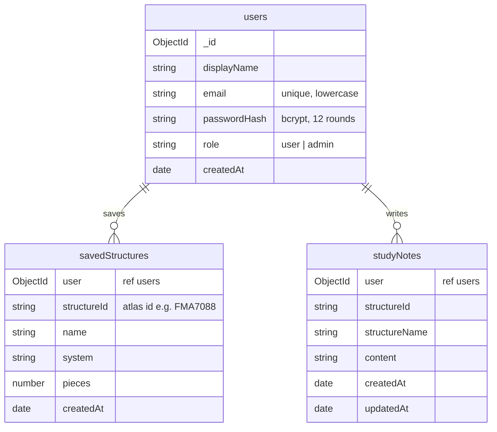

**To inspect it in Compass:**
1. Connect to `mongodb://127.0.0.1:27017`, or to your Atlas URI.
2. Open **`human_atlas_studio`**.
3. Sign in as Riya, save a structure or write a note, then refresh `savedStructures` or `studyNotes`.
4. In `users`, every `passwordHash` starts with `$2b$12$…`. Plain-text passwords are never stored.

The anatomy catalogue (thousands of meshes) stays in `client/public/models/atlas.json`. Only user data lives in MongoDB.

---

## 🔐 Authentication and security

| Layer | What it does |
| --- | --- |
| **Passwords** | bcrypt, 12 rounds; never returned by the API; login responses are identical for an unknown email and a wrong password |
| **Sessions** | JWT, 7-day expiry, in an **HttpOnly · Secure · SameSite=Lax** cookie; logout clears it |
| **Authorization** | `requireAuth` → `401`, `requireAdmin` → `403`; every query is scoped to `{ _id, user: req.user._id }`, so users can't touch each other's data |
| **Account changes** | Password change requires the current password and issues a fresh session; evaluation accounts are locked |
| **Abuse limits** | 20 sign-in or register attempts per 15 min, 30 research searches per min, 20 KB body limit |
| **Headers** | `X-Content-Type-Options: nosniff`, `X-Frame-Options: SAMEORIGIN`, strict referrer policy |

---

## 📡 REST API

| Method | Endpoint | Access | Description |
| --- | --- | --- | --- |
| GET | `/api/health` | Public | API and database status |
| POST | `/api/auth/register` | Public | `{displayName, email, password}` → `201` + cookie · `409` if the email exists |
| POST | `/api/auth/login` | Public | `{email, password}` → `200` + cookie · `401` if wrong |
| POST | `/api/auth/logout` | Public | Clears the cookie |
| GET | `/api/auth/demo` | Public | Evaluation accounts (while `SEED_DEMO_ACCOUNTS=true`) |
| GET | `/api/auth/me` | User | Current user, including `role` and `demo` |
| PATCH | `/api/auth/me` | User | `{displayName}` |
| POST | `/api/auth/password` | User | `{currentPassword, newPassword}` |
| GET | `/api/saved-structures` | User | Your saved structures |
| POST | `/api/saved-structures` | User | `{structureId, name, system, pieces}` → `201` · `409` if already saved |
| DELETE | `/api/saved-structures/:id` | User | Remove one |
| GET | `/api/notes?structureId=` | User | Your notes, optionally for one structure |
| POST | `/api/notes` | User | `{structureId, structureName, content}` → `201` |
| PATCH | `/api/notes/:id` | User | `{content}` |
| DELETE | `/api/notes/:id` | User | Delete a note |
| GET | `/api/research?term=` | User | Up to 5 PubMed articles |
| GET | `/api/admin/stats` | Admin | Totals, weekly activity, most-saved structures |
| GET | `/api/admin/users` | Admin | All users with activity counts |
| DELETE | `/api/admin/users/:id` | Admin | Delete a user and their data (not yourself or an evaluation account) |

Errors always look like `{ "error": "message", "details": { "field": "reason" } }`.

**PubMed:** the server calls NCBI E-utilities (`esearch` for ids, then `esummary` for titles, journals, dates and authors), and only when a user selects **Research**. Requests are throttled to NCBI's limit (3/s, or 10/s with a key), time out after 8 s and are cached for 6 h. Failures produce a clear message while the rest of the app keeps working.

---

## 🎨 Design and motion

The palette comes from the Atlas itself: paper `#f2f3f3`, slate `#263b48` and teal `#2f6f6a`. Type is **Newsreader** for display and **Instrument Sans** for the interface, both self-hosted. All motion uses **GSAP 3** (ScrollTrigger, SplitText) through `useGSAP`, so animations are cleaned up when you leave a page.

| Where | Motion |
| --- | --- |
| Hero | Masked headline reveal · layer scan-line wipe · X-ray lens · drawn leader lines · magnetic buttons · pointer-following glow |
| Scroll | Pinned explode scene · count-up facts · velocity-reactive marquees · self-drawing timeline · word-by-word statement |
| App | Route transitions · staggered reveals · counting statistics · animated admin bars · toasts and press feedback |
| Accessibility | Everything sits inside `gsap.matchMedia()`; with **Reduce motion** on, pages show their final state with no movement |

---

## 🧪 Testing

```sh
npm test        # 14 integration tests against a real MongoDB server (throwaway database)
npm run check   # TypeScript
npm run build   # production build
```

| Suite | Covers |
| --- | --- |
| Auth | Validation, bcrypt storage, HttpOnly cookie, duplicate email, wrong password and unknown email, logout |
| Data | Saved structures (duplicate `409`), notes (create, read, update, delete), persistence |
| Isolation | Other users' records return `404`; user ids in request bodies are ignored; private routes `401` without a session |
| Roles | Students `403` on admin routes; admins see stats and users; cascade delete; can't delete self or evaluation accounts |
| Profile | Rename, wrong current password rejected, password change takes effect; evaluation accounts locked |
| PubMed | Parsing, caching, network failure `502`, rate limit `503` |
| **Serverless** | The Vercel handler in production mode with no `JWT_SECRET`: connects, stores one generated secret, signs in with a `Secure` cookie |

The production bundle was also built with `vercel build` and its function run on its own (health, login, data). End-to-end Playwright runs cover both roles, the full study flow and repeated in-app navigation.

---

## 📁 Project structure

```
human-atlas-learning-studio-ca/
├── api/index.mjs                   Vercel entry → server/src/vercel.js
├── vercel.json                     Build, routing, caching, function settings
├── client/                         React app (Vite)
│   ├── app/page.tsx · scene.tsx    Human Atlas viewer (reused; small hooks added)
│   ├── app/site/                   Built for this project: routes, pages, auth, API client
│   │   ├── landing/                Animated hero plate and explode scene
│   │   └── pages/                  Landing, Auth, Systems, StudySpace, Profile, Admin, About
│   └── public/models · studio      3D model data · renders for the landing animations
├── server/
│   ├── src/app.js · index.js · vercel.js · db.js · seed.js · demo.js
│   ├── src/models/                 User, SavedStructure, StudyNote
│   ├── src/routes/                 auth, savedStructures, notes, research, admin
│   ├── src/middleware/             auth + roles, rate limit, validation, errors
│   └── test/                       API and serverless tests
├── docs/                           CA submission report and screenshots
└── start-mac.command               One-click local start for macOS
```

---

## 🧩 Reused and built

**Reused:** the 3D viewer from [Human Atlas](https://github.com/ashemag/human-atlas) by ashemag (MIT). That covers the Three.js renderer, the model files, system toggles, search, selection, isolation and the exploded view. The first commit in this repository is that project unmodified, so the history shows exactly what was added.

**Built for this CA:** everything else. That includes the animated landing page, routing, authentication with roles, Systems, Study Space, Profile, Admin and About, the Save/Note/Research actions in the Atlas, the Express + MongoDB backend, the PubMed integration, the evaluation accounts, the Vercel deployment, the tests and this documentation. The formal report is in [`docs/CA-SUBMISSION.md`](docs/CA-SUBMISSION.md).

---

## 📜 Credits and licences

- **Viewer code:** [Human Atlas](https://github.com/ashemag/human-atlas) © ashemag, MIT. Additions © Adhyayan Sonare, MIT ([`LICENSE`](LICENSE)).
- **Anatomy data:** **BodyParts3D**, © The Database Center for Life Science, [CC BY 4.0](https://creativecommons.org/licenses/by/4.0/). Mitsuhashi et al. (2009), *Nucleic Acids Research*. See [`client/public/ATTRIBUTION.md`](client/public/ATTRIBUTION.md).
- **Research data:** [NCBI PubMed E-utilities](https://www.ncbi.nlm.nih.gov/books/NBK25497/).
- **Fonts:** Newsreader and Instrument Sans (SIL Open Font License) via Fontsource.

<div align="center">
<br/>
<sub>Built by <a href="https://github.com/AdhyayanSonare">Adhyayan Sonare</a> · Symbiosis Institute of Technology, Nagpur · CA-03</sub><br/>
<sub>Educational use only. Not for diagnosis, treatment or surgical planning.</sub>
</div>
