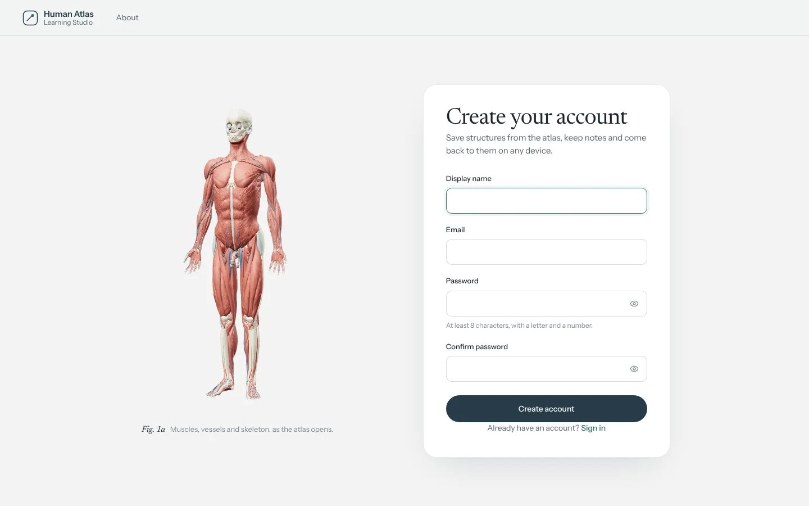

# Human Atlas Learning Studio

A full-stack anatomy study app. Explore a 3D model of 2,234 anatomical structures, save the ones you are learning, keep notes beside them and pull up related PubMed research.

Built for a college Continuous Assessment (full-stack web application) with **React, Node.js/Express and MongoDB**.


| Scroll-driven explode scene | Atlas with study actions |
| --- | --- |
|  |  |
| **Study Space** | **Create account** |
|  |  |

## Design and motion

The interface uses the Atlas's own palette (cool paper, slate ink, teal) with Newsreader and Instrument Sans. Animation is built with **GSAP 3** (ScrollTrigger and SplitText) through `@gsap/react`'s `useGSAP`, so every tween and ScrollTrigger is cleaned up when the component unmounts.

- **Hero anatomy plate:** five aligned renders of the real model (muscles, skeleton, circulation, organs, skeleton and organs) swap with a teal scan-line wipe on a timer. Each layer chip shows its own progress. Hovering the figure opens an **X-ray lens** that shows the skeleton beneath the cursor, and the labels draw in and open that structure in the atlas.
- **Headline:** split into masked lines that rise in, followed by the lede and magnetic call-to-action buttons. A soft glow follows the pointer.
- **Take it apart:** a pinned, scroll-scrubbed scene that dissolves through six real explode renders (0–100%), with a live readout and stage list.
- **Facts:** count up on entry. **Systems:** two marquees drift in opposite directions, speed up with scroll velocity and slow down on hover. **Study timeline:** draws itself as you scroll. **Closing statement:** lights up word by word.
- **App pages:** route transitions, staggered reveals on Systems and About, counting statistics in Study Space, and toast and press feedback on save, edit and delete.
- **Reduced motion:** every animation is wrapped in `gsap.matchMedia()`. With *Reduce motion* turned on, the page renders its final states with no movement.

## What it does

| Page | Route | Access |
| --- | --- | --- |
| Landing page with a labelled anatomy plate | `/` | Public |
| Sign in | `/login` | Public |
| Create account | `/register` | Public |
| Interactive 3D Atlas with save, note and research actions | `/app/atlas` | Signed in |
| Systems directory (15 systems, part counts, starting structures) | `/app/systems` | Signed in |
| Study Space: saved structures, notes (create, edit, delete) and statistics | `/app/study-space` | Signed in |
| About, technology and credits | `/about` | Public |

Deep links work: `/app/atlas?structure=FMA7088` opens the heart, and `/app/atlas?system=skeletal` shows only the skeleton.

## What was reused and what was built

**Reused (unchanged in behaviour):** the [Human Atlas](https://github.com/ashemag/human-atlas) viewer by ashemag (MIT licence): the Three.js renderer, the BodyParts3D model files, system toggles, search, selection, isolation, exploded view and camera controls. Its original README is kept at [`client/UPSTREAM-README.md`](client/UPSTREAM-README.md) and its anatomy credits at [`client/public/ATTRIBUTION.md`](client/public/ATTRIBUTION.md).

**Built for this CA:**

- Routing with React Router, a landing page, sign-in and registration, a systems directory, Study Space and an About page (`client/app/site/`).
- Small additions to the viewer (`client/app/page.tsx`): deep-link props, a navigation slot and a slot for study actions in the detail panel. The rendering engine is untouched.
- An Express 5 API (`server/`) with registration, login, logout, a session check and protected routes.
- MongoDB persistence through Mongoose for users, saved structures and study notes.
- A PubMed integration (NCBI E-utilities) that runs on the server, with a timeout, caching and throttling.
- Integration tests for the API (`server/test/`).

## Technology

| Layer | Stack |
| --- | --- |
| Frontend | React 19, TypeScript, Vite 8, React Router 7, GSAP 3 (ScrollTrigger, SplitText), Tailwind CSS 4, shadcn/Base UI components, Three.js |
| Backend | Node.js 22+, Express 5, Mongoose 8 |
| Database | MongoDB (local Community Server or MongoDB Atlas) |
| Auth | bcryptjs (12 rounds), JSON Web Token in an HttpOnly, SameSite=Lax cookie |
| External API | NCBI PubMed E-utilities (`esearch` + `esummary`) |

## Project structure

```
human-atlas-learning-studio-ca/
├── client/                    React app (Vite)
│   ├── app/
│   │   ├── page.tsx           Human Atlas viewer (reused, with small hooks added)
│   │   ├── scene.tsx          Three.js scene (reused, unchanged)
│   │   ├── anatomy.ts         Systems and types (reused)
│   │   └── site/              New: routes, pages, API client, auth, styles, landing/ animation scenes
│   ├── public/models/         BodyParts3D geometry (CC BY 4.0)
│   └── vite.config.ts         Proxies /api to the Express server in development
├── server/
│   ├── src/
│   │   ├── index.js           Starts the server and connects to MongoDB
│   │   ├── app.js             Express app, routes, production static hosting
│   │   ├── models/            User, SavedStructure, StudyNote
│   │   ├── routes/            auth, savedStructures, notes, research
│   │   ├── middleware/        auth (JWT cookie), rate limit, validation, errors
│   │   └── services/pubmed.js PubMed client with cache and throttle
│   ├── test/api.test.js       Integration tests against a real MongoDB
│   └── .env.example
└── docs/screenshots/
```

## Run it locally

### 1. Prerequisites

- **Node.js 22.13 or newer** (`node -v`).
- **MongoDB**, one of:
  - Local: install MongoDB Community Server (macOS: `brew tap mongodb/brew && brew install mongodb-community && brew services start mongodb-community`). It listens on `mongodb://127.0.0.1:27017`.
  - Cloud: a free MongoDB Atlas cluster. Copy its `mongodb+srv://…` connection string and allow your IP address under Network Access.
- **MongoDB Compass** (optional) to look at the data.

### 2. Install

```sh
npm run install:all
```

### 3. Configure the server

```sh
cp server/.env.example server/.env
```

Edit `server/.env`: set `MONGODB_URI` and set `JWT_SECRET` to a long random value:

```sh
node -e "console.log(require('crypto').randomBytes(48).toString('hex'))"
```

### Quick start on macOS

Double-click **`start-mac.command`** in Finder. It checks Node.js, starts MongoDB (installing it with Homebrew the first time), creates `server/.env` with a random secret, installs dependencies, starts both servers and opens the browser.

### 4. Start (two terminals)

```sh
# Terminal 1: API on http://localhost:5050
npm run dev:server

# Terminal 2: React app on http://localhost:3016
npm run dev:client
```

Open **http://localhost:3016**. Vite forwards `/api` requests to Express, so the cookie stays on the same origin.

The first visit to the Atlas downloads about 33 MB of model data.

### Single-server mode

```sh
npm start
```

This builds the React app and serves it from Express at **http://localhost:5050**. Setting `NODE_ENV=production` also marks the session cookie `Secure`, so use it behind HTTPS.

## Inspecting the data in MongoDB Compass

1. Open Compass and connect with the same URI as `MONGODB_URI` (for local: `mongodb://127.0.0.1:27017`).
2. Open the database **`human_atlas_studio`** (or whatever `MONGODB_DB` is set to).
3. Collections:

| Collection | Fields |
| --- | --- |
| `users` | `displayName`, `email` (lowercased, unique), `passwordHash` (bcrypt, never plain text), `createdAt`, `updatedAt` |
| `savedStructures` | `user` (ObjectId → users), `structureId` (atlas concept id, e.g. `FMA7088`), `name`, `system`, `pieces`, `createdAt`. Unique index on `{user, structureId}` |
| `studyNotes` | `user` (ObjectId → users), `structureId`, `structureName`, `content`, `createdAt`, `updatedAt` |

A demo flow: register, open the Atlas, select the heart, choose **Save**, then **Note**. Refresh Compass and the new documents appear. The anatomy catalogue itself (thousands of meshes) stays in `client/public/models/atlas.json` and is not copied into MongoDB.

## API reference

All responses are JSON. Errors look like `{ "error": "message", "details": { field: "reason" } }`.
Private routes read the user from the session cookie only. A user id sent in a request body is ignored.

| Method | Route | Auth | Purpose |
| --- | --- | --- | --- |
| GET | `/api/health` | – | API and database status (`503` if MongoDB is down) |
| POST | `/api/auth/register` | – | `{displayName, email, password}` → `201 {user}`, sets the cookie. `409` if the email exists |
| POST | `/api/auth/login` | – | `{email, password}` → `200 {user}`, sets the cookie. `401` on a wrong email or password |
| POST | `/api/auth/logout` | – | Clears the cookie |
| GET | `/api/auth/me` | ✓ | The signed-in user |
| GET | `/api/saved-structures` | ✓ | The user's saved structures, newest first |
| POST | `/api/saved-structures` | ✓ | `{structureId, name, system, pieces}` → `201`. `409` if already saved |
| DELETE | `/api/saved-structures/:id` | ✓ | Remove one (`404` if it is not yours) |
| GET | `/api/notes?structureId=` | ✓ | The user's notes, optionally for one structure |
| POST | `/api/notes` | ✓ | `{structureId, structureName, content}` → `201` |
| PATCH | `/api/notes/:id` | ✓ | `{content}` → the updated note (`404` if it is not yours) |
| DELETE | `/api/notes/:id` | ✓ | Delete a note (`404` if it is not yours) |
| GET | `/api/research?term=heart` | ✓ | Up to 5 PubMed articles: `{term, total, articles:[{pmid, title, journal, published, authors, url}]}` |

**Security notes:** bcrypt hashes with 12 rounds; JWT signed with `JWT_SECRET` and stored in an HttpOnly cookie (JavaScript cannot read it); SameSite=Lax; `Secure` in production; 20 sign-in or register attempts per 15 minutes per IP; 30 research searches per minute per IP; a 20 KB request body limit; input validation on every route; ownership enforced in every database query (`{_id, user}`).

**PubMed:** requests only go out when a user presses Research. They are throttled to NCBI's limit (3 per second, or 10 with `NCBI_API_KEY`), time out after 8 seconds and are cached for 6 hours. A failure returns a clear error and the rest of the app keeps working.

## Tests and checks

```sh
npm test                                  # API integration tests (needs MongoDB running; uses a throwaway database)
npm run check                             # TypeScript
node client/scripts/validate-atlas.mjs    # Upstream model and layout checks
node client/scripts/validate-interactions.mjs
npm run build
```

The tests cover registration validation, bcrypt storage, duplicate emails, login and logout, protected routes, duplicate saves, note create, read, update and delete, cross-user access (another user's records return `404`), and PubMed parsing, caching and failure handling (with a mocked network).

## Troubleshooting

- **"The database is not connected"**: start MongoDB (`brew services start mongodb-community`) or check `MONGODB_URI`. The API retries every 5 seconds, and `/api/health` shows the status.
- **Atlas URI fails**: allow your current IP in Atlas → Network Access, and URL-encode special characters in the password.
- **Logged out after restarting the server**: `JWT_SECRET` is missing from `.env`, so a temporary one is generated on each start. Set it.
- **Port in use**: change `PORT` in `server/.env` (and set `API_URL=http://localhost:<port>` when running the client).
- **Research shows an error**: the machine cannot reach `eutils.ncbi.nlm.nih.gov`, or NCBI is rate-limiting requests. Wait a moment and try again.

## Credits and licences

- Viewer application code: [Human Atlas](https://github.com/ashemag/human-atlas) © ashemag, MIT licence ([`LICENSE`](LICENSE)). Additions for this CA are under the same licence.
- Anatomy data: **BodyParts3D**, © The Database Center for Life Science, licensed under [CC Attribution 4.0 International](https://creativecommons.org/licenses/by/4.0/). Mitsuhashi et al. (2009), *BodyParts3D: 3D structure database for anatomical concepts*, NAR. Adaptation details: [`client/public/ATTRIBUTION.md`](client/public/ATTRIBUTION.md).
- Research data: [NCBI PubMed E-utilities](https://www.ncbi.nlm.nih.gov/books/NBK25497/).
- Fonts: Newsreader and Instrument Sans (SIL Open Font License), self-hosted via Fontsource.

This is an educational tool. Do not use it for diagnosis, treatment or surgical planning.
