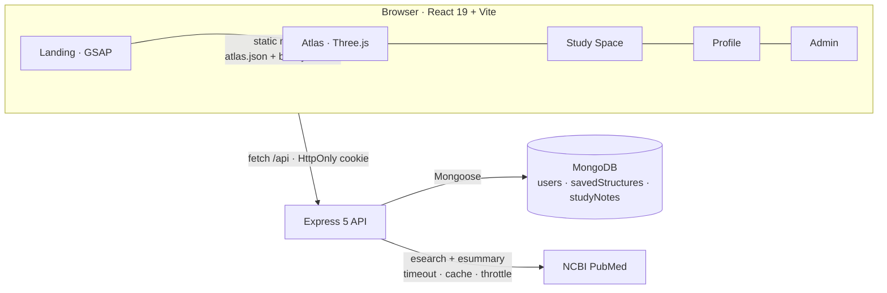
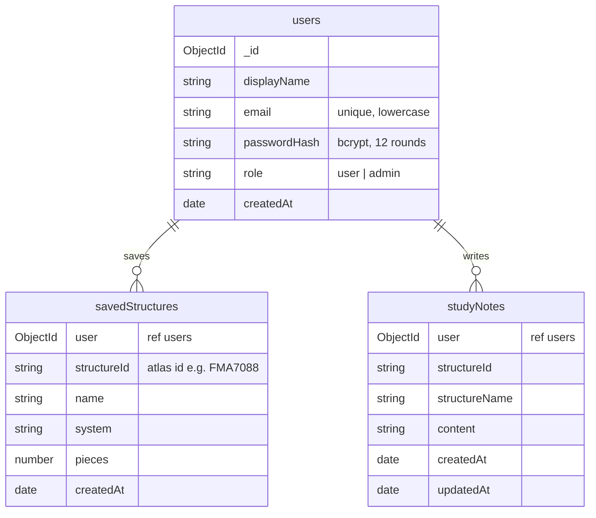

<div align="center">

# Human Atlas Learning Studio

**Study the body one structure at a time.**

A full-stack anatomy learning app: a real 3D model of 2,234 anatomical parts, private study spaces with notes, PubMed research, role-based authentication and an admin dashboard.


</div>

---

## Evaluation accounts

Both accounts are created automatically the first time the server connects to MongoDB. They are ordinary users: stored in MongoDB, with bcrypt-hashed passwords, signing in through the normal login form.

| Role | Name | Email | Password | What to try |
| --- | --- | --- | --- | --- |
| 🛡️ **Administrator** | Adhyayan Sonare | `admin@humanatlas.test` | `Admin@Atlas2026` | Admin dashboard (`/app/admin`): live totals, most-saved structures, every user, delete a user |
| 🎓 **Student** | Riya Sharma | `riya.sharma@humanatlas.test` | `Student@Atlas2026` | Study Space with 5 saved structures and 4 notes, the Atlas, Profile, research |

On the sign-in page, the **Evaluation accounts** card fills in these details; you still select **Sign in**. You can also register a new account at `/register`. To restore both accounts and their sample data at any time, run `npm --prefix server run seed`.

> These demo accounts are for local evaluation. Set `SEED_DEMO_ACCOUNTS=false` in `server/.env` before any public deployment.

---

## Contents

1. [CA rubric checklist](#ca-rubric-checklist)
2. [Feature tour](#feature-tour)
3. [Run it locally](#run-it-locally)
4. [Architecture](#architecture)
5. [Database and MongoDB Compass](#database-and-mongodb-compass)
6. [Authentication and security](#authentication-and-security)
7. [REST API](#rest-api)
8. [External API: PubMed](#external-api-pubmed)
9. [Design and motion](#design-and-motion)
10. [Testing](#testing)
11. [Project structure](#project-structure)
12. [What was reused and what was built](#what-was-reused-and-what-was-built)
13. [Credits and licences](#credits-and-licences)

---

## CA rubric checklist

| Requirement | Status | Where to see it |
| --- | :---: | --- |
| Frontend in HTML, CSS, JavaScript and **React** | ✅ | `client/`: React 19 + React Router 7, built with Vite |
| Backend in **Node.js** | ✅ | `server/`: Express 5 REST API |
| **MongoDB** persistence, visible in Compass | ✅ | Database `human_atlas_studio`: `users`, `savedStructures`, `studyNotes` |
| Frontend ↔ backend integration | ✅ | Every Study Space, Profile and Admin figure is read from MongoDB through `/api` |
| **Authentication**: register, login, logout | ✅ | `/register`, `/login`, Sign out; bcrypt + JWT in an HttpOnly cookie |
| Protected pages and protected API | ✅ | `/app/*` redirects to sign-in; private endpoints return `401` |
| **Role-based access** (student / admin) | ✅ | `/app/admin` and `/api/admin/*` return `403` for students |
| Login page and hero page | ✅ | `/login` and the animated landing hero `/` |
| Additional meaningful pages | ✅ | Atlas, Systems, Study Space, Profile, Admin, About |
| **External API** integration | ✅ | PubMed E-utilities: Related research for any structure |
| CRUD | ✅ | Saved structures (create, read, delete) · notes (create, read, update, delete) · profile (read, update) · admin (read, delete users) |
| Validation and error handling | ✅ | Client and server validation; clear messages; consistent JSON errors |
| Responsive, accessible UI | ✅ | Tested at 1440, 1280, 1024, 390 and 360 px; keyboard focus; reduced-motion support |
| Automated tests | ✅ | `npm test`: 12 API integration tests |

---

## Feature tour

### Landing page: animated hero
The hero is an anatomical plate built from five **real renders** of the 3D model (muscles, skeleton, circulation, organs, skeleton and organs), all from the same camera. Layers swap with a teal **scan-line wipe** on a timer, and each layer chip shows its own progress. Hover the figure for an **X-ray lens** that shows the skeleton beneath the cursor. Labels draw in with leader lines and open that structure in the Atlas.

### "Take it apart": scroll-driven scene
A pinned section that dissolves through six real explode renders (0% to 100%) as you scroll, with a live readout. It mirrors the explode control in the Atlas.


### Interactive 3D Atlas (`/app/atlas`)
Orbit, zoom, isolate and explode **2,234 meshes** across **15 systems**, and search **3,432 named structures**. Select any structure, then:
- **Save** it to your Study Space,
- write a **Note** about it,
- open **Research** to see the five most relevant PubMed articles.

Deep links work: `/app/atlas?structure=FMA7088` (heart), `/app/atlas?system=skeletal`.


### Study Space (`/app/study-space`)
Saved structures and notes with live statistics (saved, notes, systems covered, last activity). Notes can be created, edited and deleted, and filtered per structure. Each saved structure links back into the Atlas.


### Systems (`/app/systems`)
A filterable directory of the 15 systems with live part counts from the atlas manifest, starting structures and one-click "Show in atlas".


### Admin dashboard (`/app/admin`, administrators only)
Totals from MongoDB (users, saved structures, notes, admins), the most-saved structures as animated bars, and a searchable user table with per-user activity. Admins can delete a user, which also removes that user's data. Admins cannot delete themselves.


### Profile (`/app/profile`)
Avatar, role badge, member-since date and activity counts. Change your display name, or change your password (the current password is required, and a fresh session is issued).

| Profile | Sign in |
| --- | --- |
|  |  |

<p align="center"></p>

---

## Run it locally

### Prerequisites
- **Node.js 22.13+**
- **MongoDB**: local Community Server (`mongodb://127.0.0.1:27017`) or a free MongoDB Atlas cluster
- **MongoDB Compass** (optional) to inspect the data

### macOS one-click
Double-click **`start-mac.command`** in Finder (or right-click it and choose **Open** the first time). It checks Node, starts MongoDB (installing it with Homebrew if needed), creates `server/.env` with a random secret, installs dependencies, starts both servers and opens **http://localhost:3016**.

### Manual (any OS)
```sh
npm run install:all                  # installs server and client
cp server/.env.example server/.env   # then set MONGODB_URI and a long random JWT_SECRET

npm run dev:server                   # Terminal 1 → API on http://localhost:5050
npm run dev:client                   # Terminal 2 → app on http://localhost:3016
```

Generate a secret with `node -e "console.log(require('crypto').randomBytes(48).toString('hex'))"`.

**Single server:** `npm start` builds the React app and serves everything from Express on http://localhost:5050.

### Environment (`server/.env`)
| Variable | Default | Purpose |
| --- | --- | --- |
| `MONGODB_URI` | `mongodb://127.0.0.1:27017` | Local or Atlas connection string |
| `MONGODB_DB` | `human_atlas_studio` | Database name |
| `JWT_SECRET` | *(required)* | Signs session tokens |
| `PORT` | `5050` | API port |
| `SEED_DEMO_ACCOUNTS` | `true` | Creates the evaluation accounts |
| `NCBI_API_KEY`, `NCBI_EMAIL` | *(optional)* | Raise the PubMed rate limit from 3 to 10 requests per second |

---

## Architecture



In development, Vite proxies `/api` to Express, so the session cookie stays same-origin. In production, Express serves the built React app and the API from one port.

---

## Database and MongoDB Compass



**To look at the data in Compass:**
1. Connect to `mongodb://127.0.0.1:27017` (or your Atlas URI).
2. Open the database **`human_atlas_studio`**.
3. Sign in as Riya, save a structure or add a note in the Atlas, then refresh `savedStructures` or `studyNotes`.
4. In `users`, every `passwordHash` starts with `$2b$12$…`. Plain passwords are never stored.

The anatomy catalogue (thousands of meshes) stays in `client/public/models/atlas.json`. Only user data goes into MongoDB.

---

## Authentication and security

- **Passwords** are hashed with bcrypt (12 rounds) and never returned by the API.
- **Sessions** are a JWT signed with `JWT_SECRET`, stored in an **HttpOnly, SameSite=Lax** cookie (`Secure` in production), so JavaScript in the page cannot read the token.
- **Every private query** is scoped to the session user: `{ _id, user: req.user._id }`. A user id sent in a request body is ignored, so one user cannot read, edit or delete another user's records (covered by tests).
- **Roles:** `requireAuth` → `401`; `requireAdmin` → `403`. The client hides admin links and shows "Administrators only" if a student opens `/app/admin`.
- **Change password** requires the current password and re-issues the session.
- **Rate limits:** 20 sign-in or register attempts per 15 minutes per IP, and 30 research searches per minute.
- **Validation** of every input on the client and the server; a 20 KB request body limit; `nosniff`, `SAMEORIGIN` and referrer-policy headers.
- **Login responses are identical** for "no such email" and "wrong password", with equal hashing time.

---

## REST API

| Method | Endpoint | Access | Description |
| --- | --- | --- | --- |
| GET | `/api/health` | Public | API and database status |
| POST | `/api/auth/register` | Public | `{displayName, email, password}` → `201`, sets the cookie · `409` if the email exists |
| POST | `/api/auth/login` | Public | `{email, password}` → `200`, sets the cookie · `401` on a wrong email or password |
| POST | `/api/auth/logout` | Public | Clears the cookie |
| GET | `/api/auth/me` | User | Current user (`id, displayName, email, role, createdAt`) |
| PATCH | `/api/auth/me` | User | `{displayName}` → updated user |
| POST | `/api/auth/password` | User | `{currentPassword, newPassword}` |
| GET | `/api/auth/demo` | Public | Evaluation accounts (only while `SEED_DEMO_ACCOUNTS=true`) |
| GET | `/api/saved-structures` | User | The user's saved structures |
| POST | `/api/saved-structures` | User | `{structureId, name, system, pieces}` → `201` · `409` if already saved |
| DELETE | `/api/saved-structures/:id` | User | Remove one (`404` if it is not yours) |
| GET | `/api/notes?structureId=` | User | The user's notes, optionally for one structure |
| POST | `/api/notes` | User | `{structureId, structureName, content}` → `201` |
| PATCH | `/api/notes/:id` | User | `{content}` |
| DELETE | `/api/notes/:id` | User | Delete a note |
| GET | `/api/research?term=heart` | User | Up to five PubMed articles |
| GET | `/api/admin/stats` | Admin | Totals, weekly activity, most-saved structures |
| GET | `/api/admin/users` | Admin | All users with saved and notes counts |
| DELETE | `/api/admin/users/:id` | Admin | Delete a user and their data (not yourself) |

Errors always look like `{ "error": "message", "details": { "field": "reason" } }`.

---

## External API: PubMed

`GET /api/research?term=` searches the U.S. National Library of Medicine's PubMed through **NCBI E-utilities** (`esearch` for ids, then `esummary` for titles, journals, dates and authors). The server makes the calls, not the browser:

- requests go out only when a user selects **Research**, never when they rotate or select;
- throttled to NCBI's limit (3/s, or 10/s with an API key), with an 8-second timeout;
- results cached for 6 hours (200 entries);
- clear messages for timeouts, rate limits and empty results, while the rest of the app keeps working.

The live response format was checked against `eutils.ncbi.nlm.nih.gov`, and the parser is covered by tests.

---

## Design and motion

The palette comes from the Atlas itself (cool paper `#f2f3f3`, slate `#263b48`, teal `#2f6f6a`), with **Newsreader** for display type and **Instrument Sans** for the interface (self-hosted, so it works offline). All motion uses **GSAP 3** (ScrollTrigger, SplitText) through `@gsap/react`'s `useGSAP`, so every animation is cleaned up when the component unmounts.

| Where | Motion |
| --- | --- |
| Hero | Masked line-by-line headline, layer scan-line wipe, X-ray lens, drawn leader lines, magnetic buttons, pointer-following glow |
| Scroll | Pinned explode scene, count-up facts, velocity-reactive system marquees, a study timeline that draws itself, a closing statement revealed word by word |
| App | Route transitions, staggered reveals (Systems, About, Profile), counting statistics (Study Space, Admin, Profile), animated admin bars, toasts and press feedback on every save, edit and delete |
| Accessibility | Every animation sits inside `gsap.matchMedia()`; with **Reduce motion** on, pages render their final state with no movement |

---

## Testing

```sh
npm test        # 12 API integration tests against a real MongoDB server (uses a throwaway database)
npm run check   # TypeScript
npm run build   # production build
node client/scripts/validate-atlas.mjs && node client/scripts/validate-interactions.mjs   # upstream model checks
```

| Test | Covers |
| --- | --- |
| Health | Reports the real database state |
| Registration | Validation, bcrypt hash stored, HttpOnly cookie, duplicate email `409` |
| Login and logout | Wrong password and unknown email both `401`, session check, logout |
| Saved structures | Create, list, duplicate `409`, persistence |
| Notes | Create, edit, filter, delete, empty-note validation |
| Isolation | Another user's notes and saved items return `404`; user ids in request bodies are ignored |
| Protected routes | Every private endpoint returns `401` without a session |
| PubMed | Parsing, caching, network failure `502`, rate limit `503` |
| Evaluation accounts | Seeded student and admin can sign in; the student has sample data |
| Admin | Students get `403`; admins see stats and users, cannot delete themselves, deleting a user removes their data |
| Profile | Rename, wrong current password rejected, password change takes effect |

End-to-end browser checks (Playwright) covered register → atlas deep link → save → note → research → Study Space → refresh persists → edit → delete → logout, plus both evaluation roles and repeated in-app navigation.

---

## Project structure

```
human-atlas-learning-studio-ca/
├── client/                         React app (Vite)
│   ├── app/
│   │   ├── page.tsx                Human Atlas viewer (reused, with small hooks added)
│   │   ├── scene.tsx               Three.js renderer (reused, unchanged)
│   │   └── site/                   Built for this project
│   │       ├── App.tsx             Routes and lazy-loaded pages
│   │       ├── api.ts · auth.tsx   API client, session context, route guards
│   │       ├── gsap.ts · useReveal.ts
│   │       ├── landing/            AnatomyPlate (hero), ExplodeScene, styles
│   │       └── pages/              Landing, Auth, Systems, StudySpace, Profile, Admin, About
│   └── public/
│       ├── models/                 BodyParts3D geometry (CC BY 4.0)
│       └── studio/                 Renders used by the landing animations
├── server/
│   ├── src/
│   │   ├── app.js · index.js · db.js · config.js · seed.js
│   │   ├── models/                 User, SavedStructure, StudyNote
│   │   ├── routes/                 auth, savedStructures, notes, research, admin
│   │   ├── middleware/             auth (JWT, roles), rate limit, validation, errors
│   │   └── services/pubmed.js
│   ├── scripts/seed.js             Reset the evaluation accounts
│   └── test/api.test.js
├── docs/                           CA submission report and screenshots
└── start-mac.command               One-click local start for macOS
```

---

## What was reused and what was built

**Reused:** the 3D viewer from [Human Atlas](https://github.com/ashemag/human-atlas) by ashemag (MIT): the Three.js renderer, the model files, system toggles, search, selection, isolation and exploded view. The first commit in this repository is that project, unmodified, so the history shows exactly what was added.

**Built for this CA:** everything else. That is the landing page and all of its animation, routing, sign-in and registration, Systems, Study Space, Profile, Admin and About, the Save/Note/Research actions in the Atlas, the Express + MongoDB backend with roles, the PubMed integration, the evaluation accounts, the tests and the documentation.

See [`docs/CA-SUBMISSION.md`](docs/CA-SUBMISSION.md) for the formal submission report.

---

## Credits and licences

- Viewer code: [Human Atlas](https://github.com/ashemag/human-atlas) © ashemag, MIT. Additions © Adhyayan Sonare, MIT ([`LICENSE`](LICENSE)).
- Anatomy data: **BodyParts3D**, © The Database Center for Life Science, [CC BY 4.0](https://creativecommons.org/licenses/by/4.0/). Mitsuhashi et al. (2009), *Nucleic Acids Research*. Details in [`client/public/ATTRIBUTION.md`](client/public/ATTRIBUTION.md).
- Research data: [NCBI PubMed E-utilities](https://www.ncbi.nlm.nih.gov/books/NBK25497/).
- Fonts: Newsreader and Instrument Sans (SIL Open Font License) via Fontsource.

<p align="center"><sub>Educational use only. Not for diagnosis, treatment or surgical planning.</sub></p>
